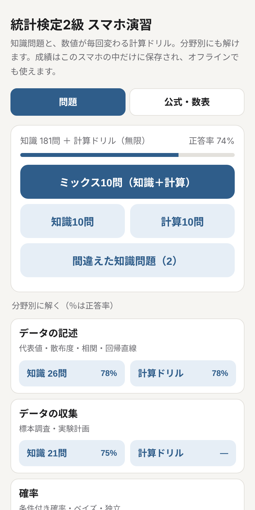
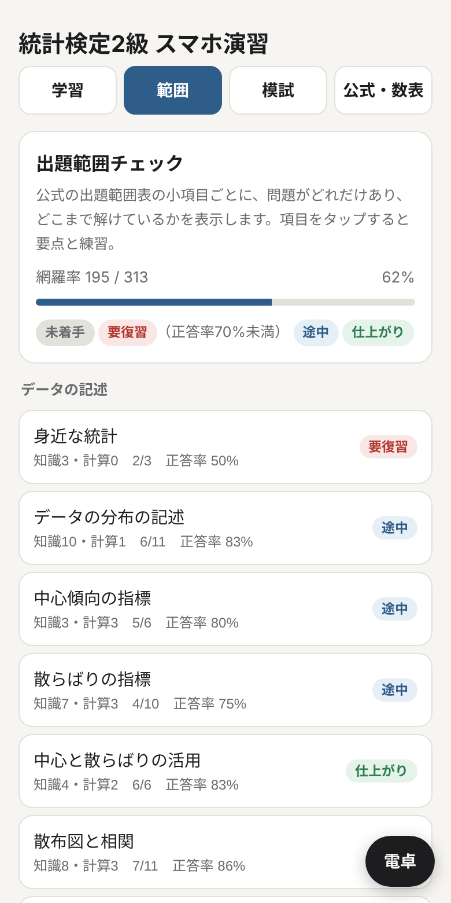
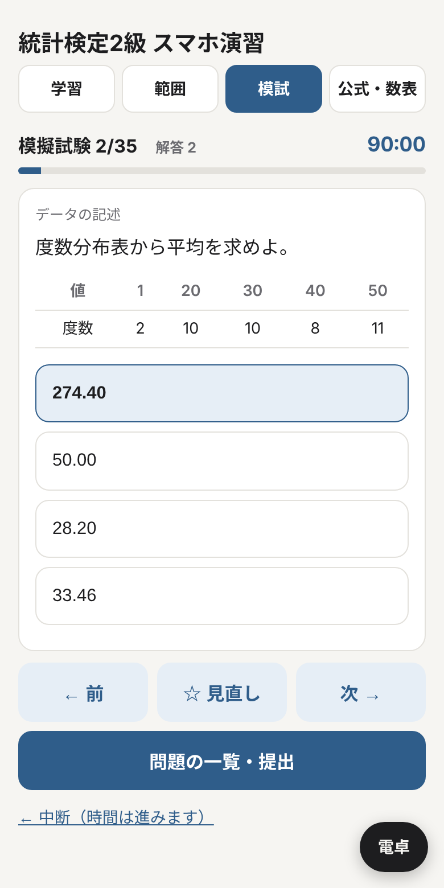
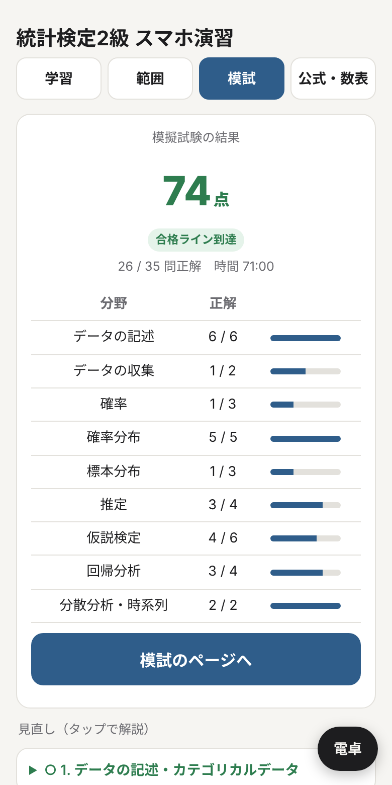
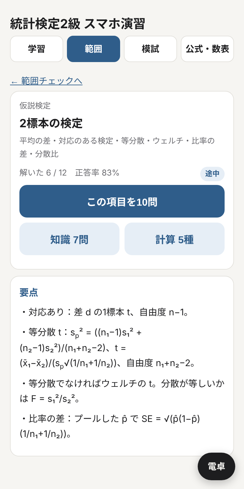
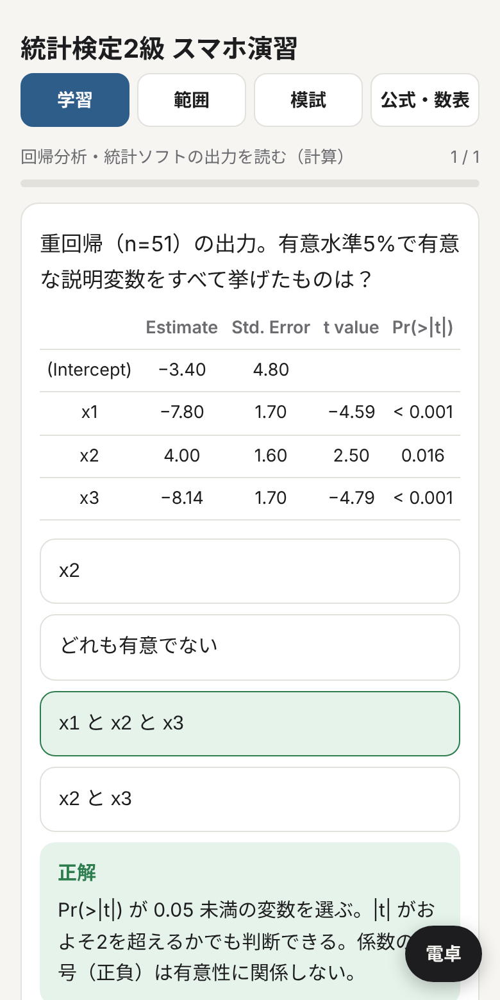
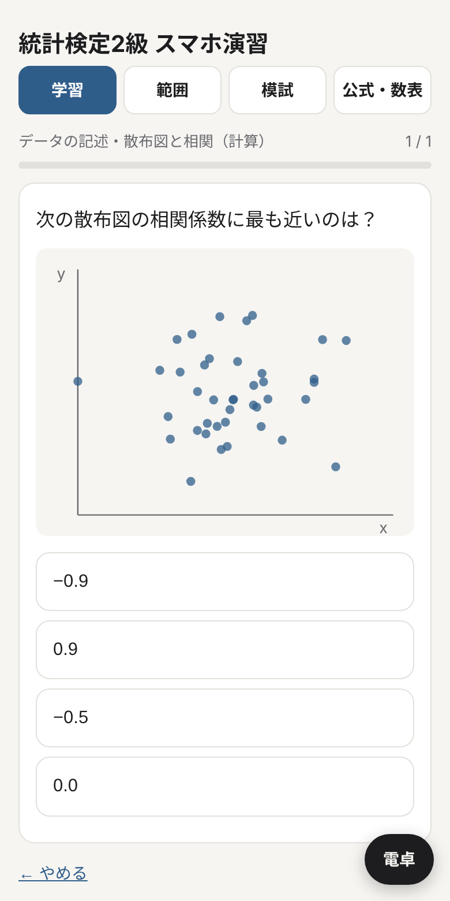
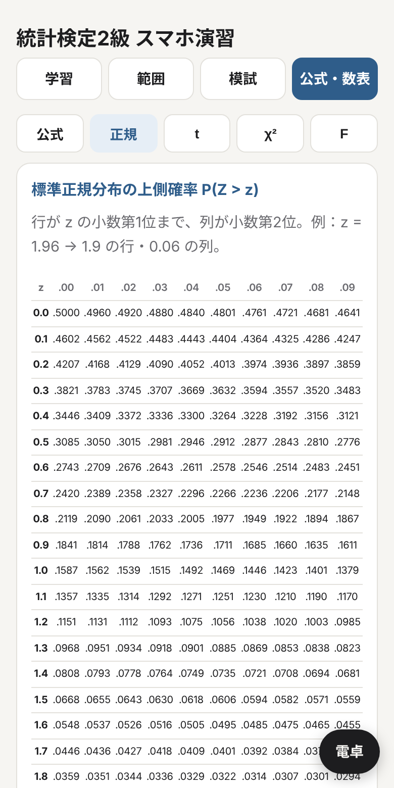
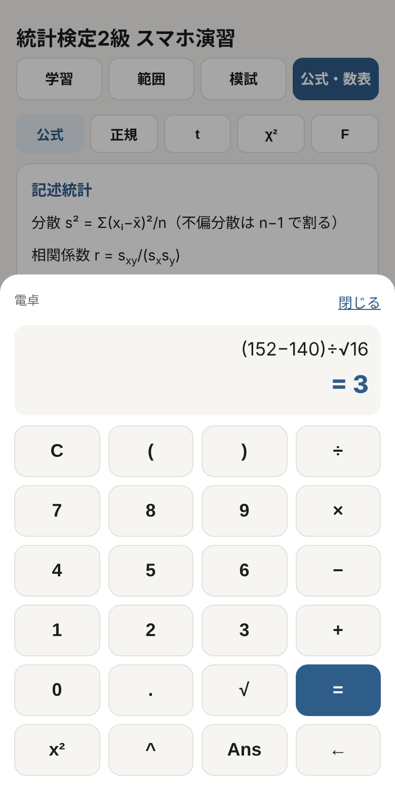
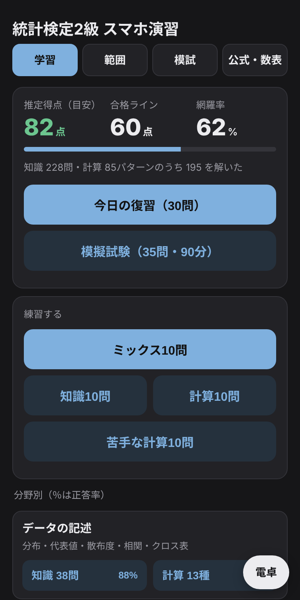

# 統計検定2級 スマホ演習

[](https://github.com/haru-ki417/stat2-app/actions/workflows/ci.yml)

**統計検定2級の出題範囲を、スマホ1台で最後まで。公式の出題範囲表の 31 項目すべてに、知識問題 228 問と数値が毎回変わる計算ドリル 85 パターンをひも付け、本番と同じ 35問・90分の模擬試験、間違えた問題の復習、要点ノート、電卓、数表までそろえたオフライン対応の Web アプリ（PWA）。**

[**アプリを開く**](https://haru-ki417.github.io/stat2-app/) — iPhone は Safari の共有ボタン →「ホーム画面に追加」で、アプリとして使えます。

<p>




</p>

左から、学習（推定得点・網羅率・今日の復習）・範囲チェック・模擬試験・模擬試験の結果。

> 個人の学習用に作ったアプリです。問題はすべてオリジナルで、日本統計学会・統計質保証推進協会とは関係ありません。合格を保証するものではないので、本番の過去問（公式問題集）と組み合わせて使ってください。

## できること

| | |
|---|---|
| **出題範囲チェック** | 公式の出題範囲表の小項目を 31 項目に分け、項目ごとに問題数・解いた数・正答率と「未着手／要復習／途中／仕上がり」を表示。抜けている項目がひと目で分かる |
| **要点ノート** | 項目ごとに押さえる公式と考え方を数行にまとめ、そのまま「この項目を10問」で練習できる |
| **模擬試験** | 本番と同じ 35問・90分。分野の配分は本番の傾向に合わせ、知識と計算（グラフ・ソフトの出力の読み取りを含む）を混ぜる。解答中は正誤を出さず、見直し印・問題一覧・残り時間つき。閉じても続きから再開でき、終わると得点・合否ライン・分野別の正解数・全問の解説を表示 |
| **今日の復習** | 間違えた知識問題は当日に、正解した問題は 1・3・7・14・30 日後にもう一度出す（間隔反復） |
| **推定得点** | 分野ごとの直近の正答率を、模擬試験の配分で重み付けした目安の点数。合格ライン 60 点と並べて表示 |
| **知識問題** | 228 問。用語・解釈・使い分け。答えるとすぐ解説が出る。まだ解いていない問題・正答率の低い問題から先に出す |
| **計算ドリル** | 85 パターン。数値を毎回ランダムに変えて出題。答えはアプリが計算する。散布図・箱ひげ図・ヒストグラム・残差プロット・コレログラムを読む問題、回帰分析や分散分析の出力表を読む問題も含む |
| **苦手な計算** | 正答率の低いパターンほど出やすくした 10 問 |
| **未回答だけ・間違いだけ** | まだ解いていない問題だけ、直近で間違えた問題だけを解く。全体・分野ごと・項目ごとに絞れて、残りの数も表示。間違いは正解すると外れ、計算は同じパターンを数値を変えて出す |
| **数表** | 標準正規分布（z = 0.00〜3.09）・t 分布・カイ二乗分布・F 分布（5%・2.5%）の表と、公式集 |
| **電卓** | 右下のボタンからいつでも。四則・かっこ・√・累乗・直前の答え（Ans） |
| **オフライン** | 一度開けば、機内モードでも起動して解ける。成績はスマホの中だけに保存し、外には送らない |

<p>




</p>
<p>


</p>

## 出題範囲と問題数

公式の出題範囲表（2級）の小項目に合わせた 31 項目です。

| 分野 | 項目 | 知識 | 計算 | 模試 |
|---|---|---:|---:|---:|
| データの記述 | 身近な統計・データの分布の記述・中心傾向・散らばり・中心と散らばりの活用・散布図と相関・カテゴリカルデータ | 38 | 13 | 6 |
| データの収集 | 観察研究と実験研究・標本調査と無作為抽出・実験の計画 | 25 | 2 | 2 |
| 確率 | 確率の基本法則・ベイズの定理 | 15 | 7 | 3 |
| 確率分布 | 確率変数と期待値・分散・離散型の分布・連続型の分布 | 29 | 14 | 5 |
| 標本分布 | 標本分布・t／χ²／F 分布 | 19 | 5 | 3 |
| 推定 | 点推定・母平均の区間推定・母比率の区間推定・母分散と平均の差の区間推定・標本サイズ | 19 | 8 | 4 |
| 仮説検定 | 検定の考え方・1標本の検定・2標本の検定・カイ二乗検定 | 31 | 13 | 6 |
| 回帰分析 | 単回帰と予測・重回帰分析・統計ソフトの出力を読む | 30 | 12 | 4 |
| 分散分析・時系列 | 分散分析と実験計画・時系列データの処理 | 22 | 11 | 2 |
| **合計** | **31 項目** | **228** | **85** | **35** |

## 計算ドリルのしくみ

問題を作る関数が数値を選んでから答えを計算します（[`js/drills.js`](js/drills.js)）。手で作った問題と違い、数値の書き間違いが起きません。図は SVG でその場で描き、回帰の出力表の p 値は t 分布から計算します。

まちがいの選択肢は、試験でやりがちな誤りから作っています。

- 標準誤差を √n で割り忘れる、標準誤差どうしを足してしまう
- 両側 5% の 1.96 と片側の 1.645、1% の 2.576 を取り違える
- 不偏分散（n−1）と標本分散（n）、母分散の区間で χ² の上側と下側を取り違える
- 成長率を算術平均する、加重平均で人数を無視する、クロス表で割る向きを間違える
- 非復元抽出なのに二項分布で計算する、連続修正を忘れる
- V[X−Y] で分散を引く、共分散の 2 倍を忘れる
- 等分散 t 検定でプールした分散を使わない、F 値の自由度を入れ替える

解説には計算の途中を数値入りで載せているので、どこで間違えたかが分かります。

## スマホに入れる

- **iPhone**: Safari で[アプリ](https://haru-ki417.github.io/stat2-app/)を開き、共有ボタン（□に↑）→「ホーム画面に追加」
- **Android**: Chrome で開き、メニュー →「ホーム画面に追加」（または「アプリをインストール」）

ホーム画面のアイコンから起動すると、アドレスバーのない全画面で開きます。成績はホーム画面のアプリ・ブラウザーそれぞれに別々に保存されます。

## しくみ

ライブラリもビルドも使わない、素の HTML・CSS・JavaScript です。

| ファイル | 内容 |
|---|---|
| [`index.html`](index.html) | 画面の骨組みと電卓 |
| [`css/style.css`](css/style.css) | スマホ向けの見た目。ライト・ダーク、ノッチの余白（safe-area）に対応 |
| [`js/tables.js`](js/tables.js) | 正規・t・カイ二乗・F 分布の数表（SciPy で計算した値） |
| [`js/topics.js`](js/topics.js) | 分野・出題範囲の 31 項目・要点ノート・模擬試験の配分 |
| [`js/questions.js`](js/questions.js) | 知識問題のデータ |
| [`js/drills.js`](js/drills.js) | 計算ドリルの問題を作る関数と、計算の部品（正規分布の累積分布関数・t 分布の p 値・組合せなど） |
| [`js/app.js`](js/app.js) | 練習・範囲チェック・模擬試験・復習の予定・推定得点・数表・電卓・成績の保存 |
| [`sw.js`](sw.js) | オフライン用のサービスワーカー |
| [`manifest.webmanifest`](manifest.webmanifest) | ホーム画面に追加したときの名前・アイコン・色 |

- **オフライン**: 初回にアプリ一式を端末に保存します。次からは保存した版をすぐ表示し、つながっていれば裏で最新版を取りに行きます（更新は次に開いたときに反映）。
- **成績の保存**: 端末の `localStorage` だけに置きます。サーバーはなく、外部への通信もしません。
- **選択肢の並び**: 表示のたびに並べ替えるので、位置で答えを覚えられません。

## テスト

```sh
node tests/check.mjs          # 問題データ・数表・計算ドリル（1 パターン 2000 回）
node tests/check.mjs 20000    # 回数を増やす
pip install playwright && python -m playwright install chromium
python3 tests/smoke.py        # スマホ幅のブラウザーで動かす
```

| テスト | 確かめること |
|---|---|
| [`tests/check.mjs`](tests/check.mjs) | 31 項目それぞれに要点と 3 問以上の問題があるか／模擬試験の配分が 35 問で、各分野に足りる問題があるか／知識問題の形（項目・選択肢の重複・正解の番号・同じ問題文）／正規分布の累積分布関数・t 分布の p 値・数表の値が正しいか／全パターンを乱数の種を固定して生成し、選択肢が 4 つとも別の値か、NaN などが出ないか／オフライン用に保存するファイルがそろっているか |
| [`tests/smoke.py`](tests/smoke.py) | スマホ幅のブラウザーで、知識問題を 10 問解く・分野別の計算ドリル・未回答だけ／間違いだけ（正解すると外れる）・範囲チェックと要点・模擬試験を 35 問解いて途中で閉じても再開し提出・数表 4 種・電卓・復習の予定・通信を切っても起動して解ける |

push のたびに GitHub Actions で両方を回します（計算ドリルは 1 パターン 5000 回）。

## 問題を追加する

知識問題は [`js/questions.js`](js/questions.js) の `Q` の**最後に**足します（成績は並び順で記録しているので、途中に入れたり消したりしない）。`t` は [`js/topics.js`](js/topics.js) の項目、正解を先頭に書いて `a:0` にします（表示のときに並べ替わります）。

```js
{t:"h_two",q:"問題文",c:["正解","誤答1","誤答2","誤答3"],a:0,e:"解説"},
```

計算ドリルは [`js/drills.js`](js/drills.js) で `add(項目, 名前, 関数)` を足します。`mk(分野, 問題文, 正解の値, [よくある誤答の値], 解説, 小数の桁, 単位)` が選択肢をそろえます。

足したら `node tests/check.mjs` を通してから push してください。Pages に反映されたあと、スマホのアプリは次に開いたときに新しい版になります。

## ライセンス

[MIT](LICENSE)
