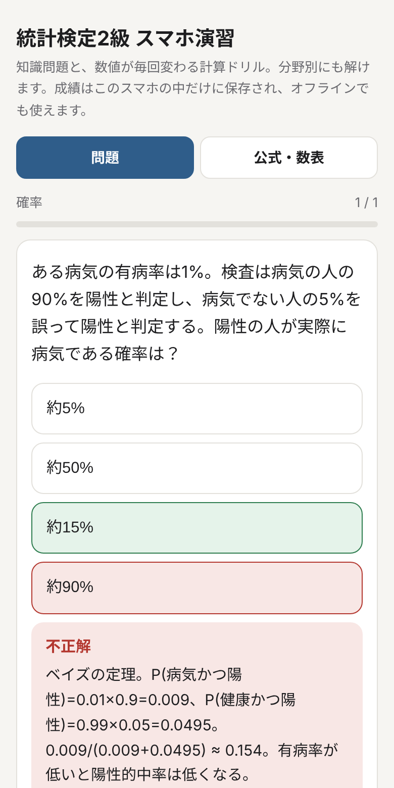
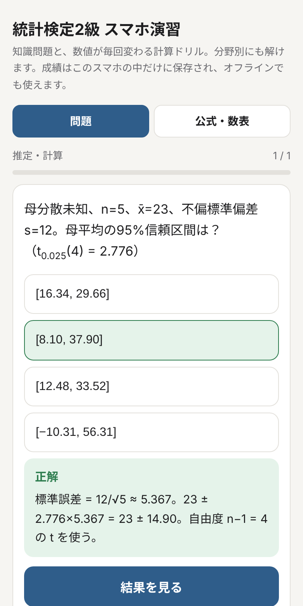
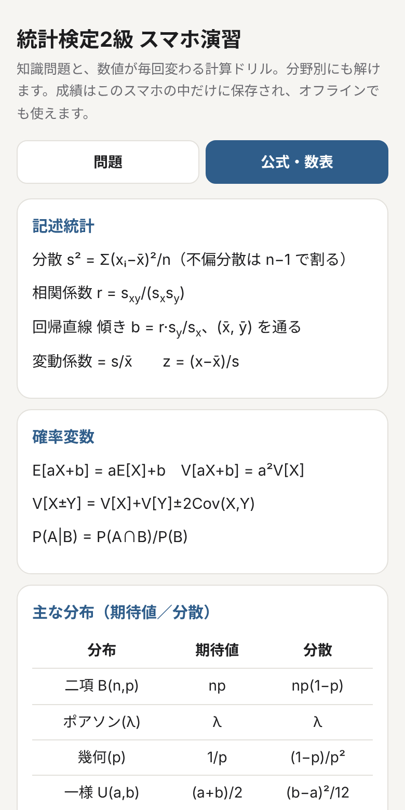

# 統計検定2級 スマホ演習

[](https://github.com/haru-ki417/stat2-app/actions/workflows/ci.yml)

**統計検定2級の対策を、スマホだけで。知識問題 181 問と、数値が毎回変わる計算ドリル 55 パターンを、分野別に解けるオフライン対応の Web アプリ（PWA）。**
ホーム画面に追加すればアプリとして起動し、電波のない場所でも使えます。成績はスマホの中だけに保存され、外には送りません。

[**アプリを開く**](https://haru-ki417.github.io/stat2-app/) — iPhone は Safari の共有ボタン →「ホーム画面に追加」で、アプリとして使えます。

<p>




</p>

左から、ホーム（分野ごとの正答率）・知識問題の解説・計算ドリル・公式と数表。

> 個人の学習用に作ったアプリです。問題はすべてオリジナルで、日本統計学会・統計質保証推進協会とは関係ありません。本番の形式（グラフや出力表を読む長い設問）の練習には、公式問題集と組み合わせて使ってください。

## できること

| | |
|---|---|
| **知識問題** | 181 問。用語・解釈・使い分け（p 値の意味、抽出法、過誤と検出力、回帰出力の読み方など）。答えるとすぐ解説が出る |
| **計算ドリル** | 55 パターン。数値を毎回ランダムに変えて出題するので、何度でも解ける。答えはアプリが計算する |
| **分野別・ミックス** | 9 分野それぞれで「知識」「計算」を選べる。全体からのミックス 10 問、知識だけ、計算だけも |
| **復習** | 間違えた知識問題を自動で記録し、正解するまで「間違えた問題」に残す |
| **成績** | 分野ごと・知識と計算ごとの正答率をホームに表示 |
| **公式・数表** | 主な分布の期待値と分散、推定・検定の公式、標準正規分布・t 分布の値、e⁻ˣ の表 |
| **オフライン** | 一度開けば、機内モードでも起動して解ける |
| **ダークモード** | スマホの設定に合わせて切り替わる |


## 分野と問題数

| 分野 | 知識問題 | 計算ドリル | 計算ドリルの例 |
|---|---:|---:|---|
| データの記述 | 26 | 8 | 標準偏差・中央値・相関係数・回帰直線の予測値・偏差値・外れ値の境界・幾何平均・全体平均 |
| データの収集 | 21 | 2 | 層化抽出の比例配分・系統抽出の番号 |
| 確率 | 14 | 6 | サイコロの和・和事象・「少なくとも 1 回」・ベイズの定理（陽性的中率）・非復元抽出・条件付き確率 |
| 確率分布 | 23 | 10 | 二項分布・ポアソン分布・aX+b・V[X±Y]・正規分布の確率・指数分布・一様分布・幾何分布 |
| 標本分布 | 16 | 4 | 標準誤差・標本平均の確率・和の分散・各検定の自由度 |
| 推定 | 17 | 6 | 平均の信頼区間（z・t）・比率の信頼区間・必要な標本サイズ・区間の幅 |
| 仮説検定 | 27 | 8 | z 値・棄却の判断・比率の検定・対応のある t・期待度数・カイ二乗統計量・2 標本の z |
| 回帰分析 | 20 | 6 | t 値・決定係数・残差・自由度調整済み R²・重回帰の予測値 |
| 分散分析・時系列 | 17 | 5 | 自由度・F 値・群内平均平方・移動平均・ラスパイレス指数 |
| **合計** | **181** | **55** | |

## 計算ドリルのしくみ

問題を作る関数が、数値を選んでから答えを計算します（[`js/drills.js`](js/drills.js)）。手で作った問題とちがい、数値の書き間違いが起きません。

まちがいの選択肢は、試験でやりがちな誤りから作っています。

- 標準誤差を √n で割り忘れる（σ をそのまま使う）
- 両側 5% の 1.96 と片側の 1.645、1% の 2.576 を取り違える
- 不偏分散（n−1）と標本分散（n）を取り違える
- 成長率を算術平均してしまう、加重平均で人数を無視する
- 非復元抽出なのに玉を戻した計算をする
- V[X−Y] で分散を引いてしまう、共分散の 2 倍を忘れる

解説には計算の途中を数値入りで載せているので、どこで間違えたかが分かります。

## スマホに入れる

- **iPhone**: Safari で[アプリ](https://haru-ki417.github.io/stat2-app/)を開き、共有ボタン（□に↑）→「ホーム画面に追加」
- **Android**: Chrome で開き、メニュー →「ホーム画面に追加」（または「アプリをインストール」）

ホーム画面のアイコンから起動すると、アドレスバーのない全画面で開きます。成績はホーム画面のアプリ・ブラウザーそれぞれに別々に保存されます。

## しくみ

ライブラリもビルドも使わない、素の HTML・CSS・JavaScript です。

| ファイル | 内容 |
|---|---|
| [`index.html`](index.html) | 画面の骨組み |
| [`css/style.css`](css/style.css) | スマホ向けの見た目。ライト・ダーク、ノッチの余白（safe-area）に対応 |
| [`js/questions.js`](js/questions.js) | 分野と知識問題のデータ |
| [`js/drills.js`](js/drills.js) | 計算ドリルの問題を作る関数と、計算の部品（正規分布の累積分布関数・組合せ・分数など） |
| [`js/app.js`](js/app.js) | 出題・採点・成績の保存・画面の切り替え・公式と数表 |
| [`sw.js`](sw.js) | オフライン用のサービスワーカー |
| [`manifest.webmanifest`](manifest.webmanifest) | ホーム画面に追加したときの名前・アイコン・色 |

- **オフライン**: 初回にアプリ一式を端末に保存します。次からは保存した版をすぐ表示し、つながっていれば裏で最新版を取りに行きます（更新は次に開いたときに反映）。
- **成績の保存**: 端末の `localStorage` だけに置きます。サーバーはなく、外部への通信もしません。
- **選択肢の並び**: 表示のたびに並べ替えるので、位置で答えを覚えられません。

## テスト

```sh
node tests/check.mjs          # 問題データと計算ドリル（1 パターン 2000 回）
node tests/check.mjs 20000    # 回数を増やす
pip install playwright && python -m playwright install chromium
python3 tests/smoke.py        # スマホ幅のブラウザーで動かす
```

| テスト | 確かめること |
|---|---|
| [`tests/check.mjs`](tests/check.mjs) | 知識問題の形（分野・選択肢の重複・正解の番号・同じ問題文）／正規分布の累積分布関数・組合せ・分数・t 分布の値が正しいか／全パターンを乱数の種を固定して生成し、選択肢が 4 つとも別の値か、NaN などが出ないか／オフライン用に保存するファイルがそろっているか |
| [`tests/smoke.py`](tests/smoke.py) | スマホ幅のブラウザーで、知識問題を 10 問解いて結果が出る・分野別の計算ドリルが開く・公式が出る・成績が保存される・通信を切っても起動して解ける |

push のたびに GitHub Actions で両方を回します（計算ドリルは 1 パターン 5000 回）。

## 問題を追加する

知識問題は [`js/questions.js`](js/questions.js) の `Q` に 1 行足します。正解を先頭に書き、`a:0` にします（表示のときに並べ替わります）。

```js
{f:"test",q:"問題文",c:["正解","誤答1","誤答2","誤答3"],a:0,e:"解説"},
```

計算ドリルは [`js/drills.js`](js/drills.js) の `GEN[分野]` に関数を足します。`mk(分野, 問題文, 正解の値, [よくある誤答の値], 解説, 小数の桁, 単位)` が選択肢をそろえます。

足したら `node tests/check.mjs` を通してから push してください。Pages に反映されたあと、スマホのアプリは次に開いたときに新しい版になります。

## ライセンス

[MIT](LICENSE)
